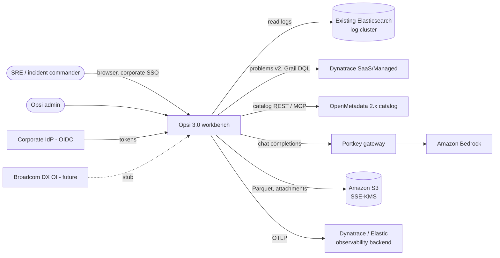
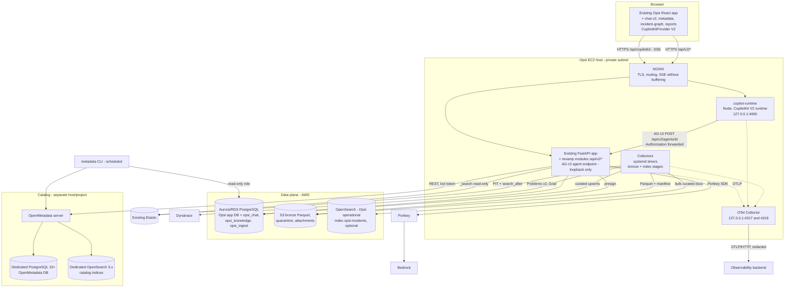
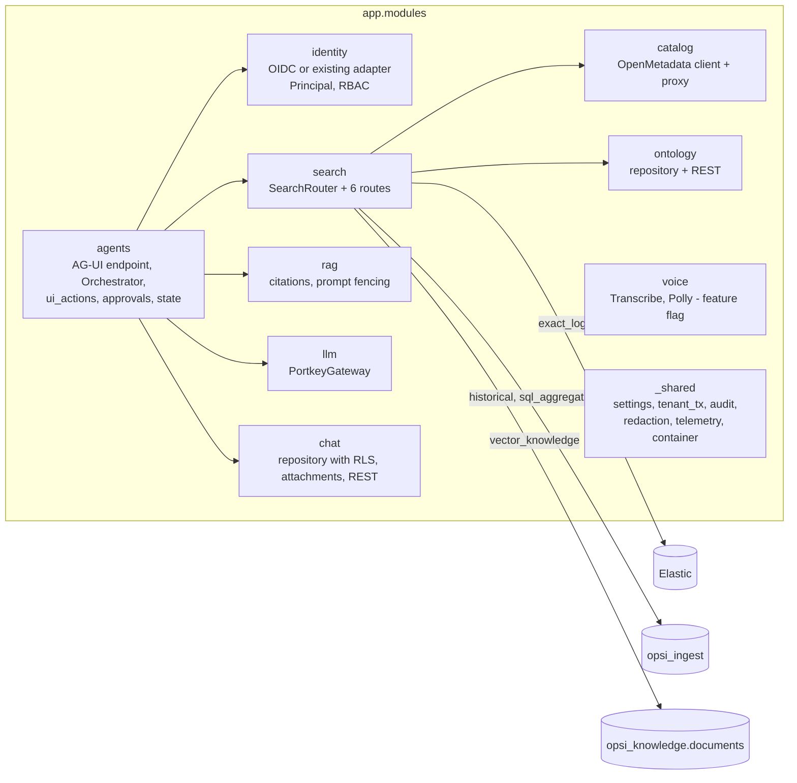
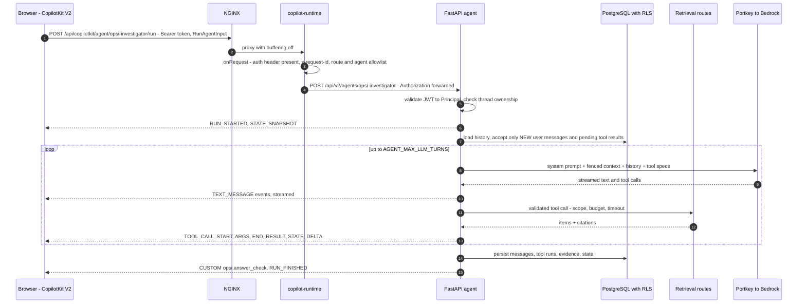
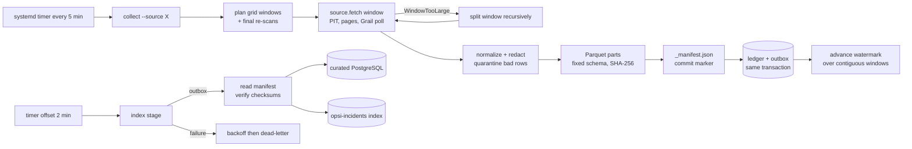
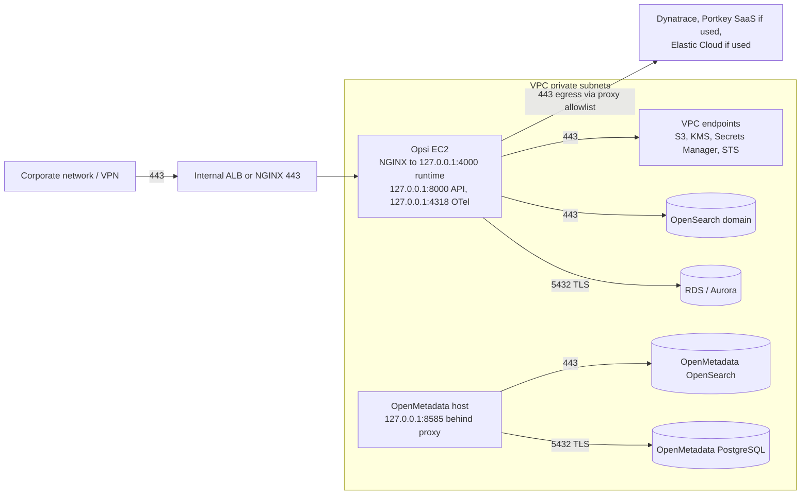

# Architecture - Opsi 3.0 observability intelligence workbench

Audience: engineers and reviewers. Diagrams are Mermaid (render on GitHub/GitLab or VS Code with a
Mermaid extension). Decisions are justified in [adr/](adr/README.md); threats in [threat-model.md](threat-model.md).

## 1. System context (C4 level 1)

Out of scope: changing the existing Opsi production app, its database, NGINX routing or network policy.

## 2. Containers (C4 level 2)

### Responsibilities (who owns what)

| Concern | Owner | Never |
|---|---|---|
| Catalog metadata: tables, columns, owners, domains, tags, data lineage | **OpenMetadata** (via its API) | write to OpenMetadata's DB; share its DB/schema/indices with Opsi |
| Operational knowledge: incidents, services, hosts, dependencies, evidence, hypotheses (time-scoped, with provenance) | **Opsi PostgreSQL** `opsi_knowledge` | assume OM lineage = incident causality |
| Raw operational events | **S3 bronze** (Parquet, immutable runs) | bulk-load into PostgreSQL |
| Curated subset (problems, error signatures, evidence samples) | `opsi_ingest` (+ optional OpenSearch `opsi-incidents`) | raw payloads |
| Chat threads, messages, citations, tool runs, approvals, feedback | `opsi_chat` (RLS) | CopilotKit Intelligence / browser storage as the system of record |
| Identity & authorization | Existing Opsi auth or OIDC validation in FastAPI | trust tenant/user from client body, AG-UI state or context |
| Model inference | Portkey -> Bedrock, server-side only | model keys in the browser; parallel model clients |
| Presentation & UI actions | CopilotKit V2 in React (frontend tools, HITL, renderers) | execute model-generated code/HTML; mutate records without approval |

## 3. Components inside the API (C4 level 3)

Route catalogue (tools the model can call; all read-only, validated, budgeted, cited):

| Route | Backend | Limits | Citation |
|---|---|---|---|
| `exact_logs` | existing Elasticsearch `_search` (index from tenant map, allowlisted) | 24 h window, 50 hits, no wildcard/fuzzy operators | `elastic://<index>/_doc/<id>` |
| `metadata_search` | OpenMetadata search / table-by-FQN / lineage | 10 entities, lineage depth <= 3 | `om://<type>/<fqn>` |
| `historical_incident_search` | `opsi_ingest.problems` FTS | 90 days, 20 rows | `dynatrace-problem://<id>` |
| `service_graph` | `opsi_knowledge.neighborhood()` | depth <= 3, 80 edges, scope-filtered | `ontology://edge/<id>` |
| `sql_aggregation` | named SQL templates only | 30 days, 200 rows | `sql://opsi_ingest/<template>?...` |
| `vector_knowledge` (optional) | pgvector HNSW | 8 docs, similarity floor | runbook `source_ref` |

## 4. Key flows

### 4.1 "Why is this incident happening?" (agent run)

### 4.2 UI action and human approval

1. Model calls `set_dashboard_filter` -> server validates args + scope -> streams TOOL_CALL_* (no result) -> run ends.
2. CopilotKit runs the registered `useFrontendTool` handler -> page listener applies the filter -> new run with the tool result.
3. For `draft_incident_update` the server first creates an `action_approvals` row; the HITL card calls
   `POST /api/v2/actions/{id}/decision` **with the user's own session**; only then does an executor run.

### 4.3 Ingestion

### 4.4 Thread restore after re-login
Browser `GET /api/v2/chat/threads?...` -> select -> `GET /threads/{id}/messages` (AG-UI wire messages, evidence,
state) -> `agent.setMessages()` + `agent.setState()` -> `<CopilotChat threadId=...>`. The server re-reads history
from PostgreSQL on every run, so a tampered browser transcript cannot change what the model sees.

## 5. Network view

Rules: no public IPs; security groups allow only listed ports from listed sources; Docker ports bound to
127.0.0.1 (Docker bypasses host firewalls); egress allowlisted by FQDN. *Bedrock is reached by Portkey -
from wherever Portkey runs (self-hosted gateway in the VPC is preferred for data residency).

## 6. Data model summary
- `opsi_ingest`: watermarks, window_ledger, outbox, runs, operator_actions (collector state) + problems,
  error_signature_windows, evidence_samples, window_index_state (curated).
- `opsi_chat`: folders, threads, messages, tags, thread_tags, attachments, agent_runs, tool_runs, evidence_refs,
  action_approvals, feedback. `opsi_audit.events` append-only.
- `opsi_knowledge`: entity_kinds, relation_types, entities, edges (valid_from/valid_to, confidence, provenance,
  evidence_ref), catalog_xrefs (OpenMetadata FQN/UUID), documents (pgvector, optional).
Details: [data-contracts.md](data-contracts.md) and `database/migrations/`.

## 7. Quality attributes and how they are met

| Attribute | Mechanism |
|---|---|
| Tenant isolation | Principal from token; `tenant_tx` sets `opsi.tenant_id`; RESTRICTIVE RLS; tests for cross-tenant/user denial |
| No data loss in ingestion | grid ledger, manifest commit marker, watermark over contiguous windows, outbox, final re-scan, split-not-truncate |
| Explainability | citations on every route result; `[cN]` validation; evidence persisted per message |
| Safety of actions | allowlisted UI actions, schema validation, scope checks, approvals with expiry/four-eyes, audit |
| Prompt-injection resistance | fenced untrusted data, server-owned history, tools cannot write, no code execution |
| Privacy | redaction at ingest and in API, content-free telemetry, collector redaction, no voice retention |
| Operability | systemd timers + OnFailure alerts, status/gap reports, runbooks, health script |
| Evolvability | contracts (event schema, route args, AG-UI), pinned versions, verify scripts, ADRs |

## 8. Growth path
Phase 1 lab -> Phase 2 hardening (SSO, RLS, backups) -> Phase 3 dedicated OpenSearch, trace correlation, vector
knowledge, agent canvas -> Phase 4 streaming ingestion (Kinesis/MSK), lakehouse (Iceberg on S3 + Athena), voice.
See [consultations/12-release-rollout-rollback.md](consultations/12-release-rollout-rollback.md).
