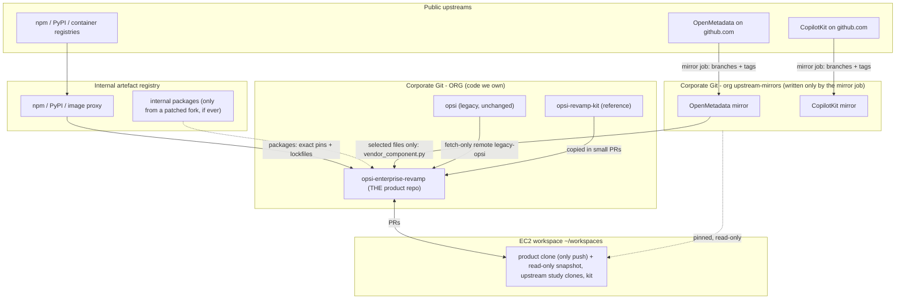

# Repository strategy: forks, mirrors, workspaces and third-party code

How to set up and run every Git repository involved in the Opsi revamp so that the enterprise side sees
**one clean product repository**, upstream projects stay separate and current, and nobody has to guess where
code came from. Decision record: [ADR-0020](adr/0020-mirrors-packages-selective-vendoring.md). Executable
setup prompt: [../REPO_SETUP_MASTER_PROMPT.md](../REPO_SETUP_MASTER_PROMPT.md).

Contents: [1 Answer](#1-the-answer-in-ten-lines) - [2 Terms](#2-terms-that-get-mixed-up) - [3 Facts](#3-facts-that-drive-the-design) -
[4 Architecture](#4-final-architecture) - [5 Decision ladder](#5-decision-ladder-how-a-component-enters-the-product) -
[6 Per component](#6-per-component-decisions-openmetadata-copilotkit-and-the-rest) - [7 Submodule vs subtree vs vendoring](#7-submodules-subtrees-vendoring-vendir-compared) -
[8 EC2 workspace](#8-the-ec2-workspace-workbook) - [9 Product repo](#9-the-product-repository-layout-and-rules) -
[10 Maintenance](#10-maintenance-workflows-and-cadence) - [11 Development flow](#11-development-workflow) -
[12 Day-1 setup](#12-day-1-setup-procedure) - [13 Anti-patterns](#13-anti-patterns) - [14 Checklist](#14-checklist) -
[15 Master prompt](#15-how-to-write-a-master-prompt-for-this-kind-of-work)

---

## 1. The answer in ten lines

1. **Do not fork on github.com.** Keep **private mirrors** of the upstream projects (OpenMetadata, CopilotKit, ...) in a
   dedicated corporate Git org (`upstream-mirrors`). Only a scheduled job writes to them; nobody commits there.
2. Have **exactly one product repository**, `opsi-enterprise-revamp`. It contains code you own plus a small, audited
   `third_party/` folder. It never contains a whole upstream repository, and it has no submodules.
3. **Bring components, not repositories.** CopilotKit, AG-UI, ECharts, React Flow and `@rjsf` come in as exactly
   pinned **npm packages**. OpenMetadata runs as a **separate service** (container image) that you call through its
   **REST API**. If you need OpenMetadata's JSON Schemas, **vendor only those files**, with provenance.
4. Legacy Opsi stays untouched. You get a **read-only snapshot clone**, and the product repo has a fetch-only
   `legacy-opsi` remote for cherry-picking hotfixes ([ADR-0001](adr/0001-separate-revamp-repository.md)).
5. On the EC2 box, the **workspace** (the "workbook") is a folder per role (`opsi-baseline-snapshot/`,
   `opsi-enterprise-revamp/`, `upstream/`, `reference/`, `scratch/`). A manifest describes it, and
   [`scripts/repo/workspace.py`](../scripts/repo/workspace.py) creates and checks it. Push is disabled on everything
   except the product repo.
6. A **patched fork** is a last resort. When you need one, it is a separate private repo that rebases a short patch
   branch onto upstream release tags and **publishes an internal package**. The product still consumes a package.
7. CI keeps the product clean:
   [`repo_hygiene.py`](../scripts/repo/repo_hygiene.py) (no submodules, stray licences, junk or unlocked
   `package.json`), [`vendor_component.py verify`](../scripts/repo/vendor_component.py) (vendored files match their
   recorded upstream), the secret scan, the licence scan, and CODEOWNERS review on `third_party/` and lockfiles.
8. Upstream updates are **deliberate PRs**: a Dependabot/Renovate group for packages, `diff-upstream` plus `update`
   for vendored files, and `workspace.py upstream-updates` for the study clones. Nothing floats.
9. This kit is a **reference repo**. Its content moves into the product as small PRs, following
   [commit-plan.md](commit-plan.md). It is never a submodule or a runtime dependency.
10. Writing a master prompt for this setup:
    [section 15](#15-how-to-write-a-master-prompt-for-this-kind-of-work) and
    [../REPO_SETUP_MASTER_PROMPT.md](../REPO_SETUP_MASTER_PROMPT.md).

## 2. Terms that get mixed up

| Term | What it is | Where it fits here |
|---|---|---|
| **Clone** | A local copy of a repository with full or partial history | every folder in the EC2 workspace |
| **Fork** (GitHub feature) | A server-side copy linked to its parent in the same GitHub instance. It shares the parent's network and visibility rules | **not used** for public upstreams (see section 3) |
| **Mirror** | A separate repository that receives the upstream's branches and tags from a sync job. It has no link to the parent | `upstream-mirrors/OpenMetadata`, `upstream-mirrors/CopilotKit` |
| **Package** | A released, versioned artefact (npm, PyPI, container image) | CopilotKit, AG-UI, ECharts, FastAPI, the OpenMetadata server image |
| **Vendoring** | Copying selected upstream **files** into your repo and recording where they came from | `third_party/` + `VENDORED.json` |
| **Patch (package patch)** | A small diff applied to an installed package at install time | `patches/` + `patch-package` (temporary only) |
| **Patched fork** | A private copy of an upstream repo that carries your own commits and publishes an internal package | last resort; a separate repo |
| **Submodule** | A pointer from your repo to a commit of another repo (a gitlink plus `.gitmodules`) | **not used** in the product |
| **Subtree** | Another repo's tree merged into a subfolder of yours, history included | **not used** for upstream monorepos |
| **Partial clone** | `git clone --filter=blob:none`: file contents download on demand | study clones of big upstreams |
| **Worktree** | Extra checkouts of one clone at different refs (`git worktree add`) | comparing OpenMetadata 1.x and 2.x side by side |

## 3. Facts that drive the design

| Fact | Consequence | Source |
|---|---|---|
| A fork of a **public** repository is always public, and you cannot change a fork's visibility | One accidental push of internal code to a "corporate fork" of OpenMetadata or CopilotKit publishes it. So: mirrors, not forks | GitHub Docs: *About permissions and visibility of forks*; *Setting repository visibility* |
| GitHub Enterprise Server is a separate instance and cannot fork github.com repositories | The supported way to get upstream code into corporate Git is a mirror (`git clone --bare` then push), and the docs describe exactly that | GitHub Docs: *Duplicating a repository* |
| GitHub exposes read-only `refs/pull/*`. `git push --mirror` from a full mirror clone tries to push them and fails | The mirror job copies `refs/heads/*` and `refs/tags/*` only ([`mirror_upstream.sh`](../scripts/repo/mirror_upstream.sh)) | observed behaviour; the GitHub docs' mirror example |
| The OpenMetadata repo is about 3.2 GB and CopilotKit about 0.9 GB (full clones, 2026-10) | Whole repos inside the product would dwarf Opsi, slow CI and bury reviews. Study clones use `--filter=blob:none` | measured while building the kit |
| OpenMetadata is Apache-2.0 **except `ingestion/`**, which is under the Collate Community License 1.0 (not OSI-approved) | Licence is decided **per path**, not per repo. `vendor_component.py` refuses `ingestion/` without a legal approval reference | [license-inventory.md](license-inventory.md), [ADR-0018](adr/0018-openmetadata-ingestion-license-review.md) |
| CopilotKit (MIT) and AG-UI (MIT) ship as npm packages and change fast. `@ag-ui/client` must equal the runtime's own dependency | Consume them as exactly pinned packages, update them as a group, and run the export-verification scripts ([ADR-0017](adr/0017-pin-versions-verify-scripts.md)) | [verified-facts.md](verified-facts.md) |
| OpenMetadata's JSON Schemas live in `openmetadata-spec/src/main/resources/json/schema/` and reference each other through relative `$ref` | If you vendor schemas, vendor the closure: the entity files plus `type/` and every other referenced file | upstream tree at `2.0.6-release` |

## 4. Final architecture



The arrows into `opsi-enterprise-revamp` are the **only** ways code enters the product: packages, selected
vendored files, legacy hotfix cherry-picks, kit content as PRs, and (rarely) an internal package from a patched fork.
Anything else, such as a submodule, a copied folder or a pasted file, fails a CI check or a code-owner review.

### Repository inventory

| Repository | Role | Visibility | Who writes | How it changes |
|---|---|---|---|---|
| `upstream-mirrors/OpenMetadata`, `upstream-mirrors/CopilotKit` | mirror | private/internal | the mirror service account only (branch protection, no human push) | scheduled job ([`mirror-sync.example.yml`](../infrastructure/repo/mirror-sync.example.yml)) |
| `upstream-mirrors-admin` | holds the mirror job and its config | private | platform team | PR |
| `ORG/opsi` (legacy) | production code today | unchanged | the existing team, as today | not touched by the revamp; read via `legacy-opsi` |
| `ORG/opsi-enterprise-revamp` | **product** | private | revamp team through PRs only | PRs with required checks, CODEOWNERS |
| `ORG/opsi-revamp-kit` | reference (this kit) | private | kit maintainers | PR; pull-only on EC2 |
| `ORG/opsi-fork-<project>` | patched fork, only when the ladder reaches step 6 | private | 1-2 named maintainers | patch branch rebased onto release tags; publishes an internal package |

Why mirrors at all, when packages come from registries? Because they give you a **pinned, scanned, always-available
source** for studying code, generating types, vendoring selected files and building a patched fork, without anyone
needing github.com access from the EC2 box. If your policy allows direct github.com reads from EC2, the mirrors are
optional at first. Add them before you vendor anything.

## 5. Decision ladder: how a component enters the product

Take the **first** rung that works. Each rung down costs more maintenance.

| Rung | Mechanism | Lives in product as | Upgrade cost | Use for |
|---|---|---|---|---|
| 1 | **Run it as a service** (container image, API) | compose/deployment config + a small API client | bump an image tag/digest, run contract tests | OpenMetadata server, OpenSearch, the OTel collector |
| 2 | **Depend on a package** (exact pin, lockfile, internal proxy) | `package.json` + lockfile, `requirements/*.txt` | Dependabot PR plus verify scripts | CopilotKit, AG-UI, ECharts, React Flow, `@rjsf`, FastAPI, ... |
| 3 | **Generate from a published contract** (OpenAPI / JSON Schema) | generator config + generated code (`linguist-generated`) | regenerate at the new tag, review the diff | OpenMetadata entity types for the API client |
| 4 | **Vendor selected files with provenance** | `third_party/<project>/...` + `VENDORED.json` + LICENSE/NOTICE | `diff-upstream`, `update`, re-apply recorded edits | the OM schema subset that feeds rung 3; small utilities with no package |
| 5 | **Patch a package temporarily** | `patches/<pkg>+<ver>.patch` + upstream issue link + expiry date | the patch fails loudly when the package moves | a CopilotKit bug fixed upstream but not yet released |
| 6 | **Patched fork** (separate repo) | the internal package version only | rebase the patch branch every release | a long-lived change upstream won't take, or a patch too big for rung 5 |
| never | whole upstream repos, submodules or subtrees of upstream monorepos, copied OM UI components, OM `ingestion/` without legal approval | - | - | - |

So, to the direct question **"do we bring the whole GitHub repo or only the components we need?"**: only the
components, and in most cases not even as source. Packages and services cover almost everything. Source files
enter only through rung 4, file by file, with a recorded reason, licence and approval.

## 6. Per-component decisions (OpenMetadata, CopilotKit and the rest)

| Component | What Opsi needs | Rung | How it enters | Where it lives in the product | Update path |
|---|---|---|---|---|---|
| OpenMetadata server 2.0.6 | catalog service | 1 | release container image, pinned (tag plus digest in prod) | `infrastructure/compose/*openmetadata*`, deployment config | OM upgrade notes, then a lab run, then a digest bump PR |
| OpenMetadata REST API | search, entity lookup, lineage | 1 (+3) | our own small `httpx` client | `apps/opsi-api/app/modules/catalog/openmetadata.py` | contract test against the lab after each OM upgrade |
| OpenMetadata JSON Schemas | typed models for the client (optional) | 4 to 3 | `vendor_component.py add` of the needed entity files **plus their `$ref` closure** (`type/`), then generate (e.g. `datamodel-code-generator`, verify its licence when you add it) | `third_party/openmetadata/schema/` to `apps/opsi-api/.../generated/` | `diff-upstream --to <new tag>`, `update`, regenerate |
| OpenMetadata UI | ideas for admin screens | none | **not copied** (antd 4 + OM state coupling). Use the same libraries (`@rjsf/core`, `@xyflow/react`) with Opsi's own schemas | - | - |
| OpenMetadata ingestion (`metadata` CLI, `openmetadata-ingestion`) | load Opsi DB metadata into OM | 1 (separate runtime) | installed in its **own** venv/container on the OM side, after legal review. **Not** a product dependency | config template only: `infrastructure/openmetadata/` | pinned to the server version |
| OM Python SDK (inside the ingestion package) | - | avoid | the same licence as ingestion. Use the REST client instead | - | - |
| CopilotKit `react-core` / `runtime` (V2) | chat UI, runtime bridge | 2 | npm, exact versions, Dependabot group `copilotkit` | `apps/opsi-web`, `apps/copilot-runtime` (+ lockfiles) | group PR, then `verify-copilotkit-v2.mjs` + `check:exports` |
| AG-UI (`@ag-ui/client`, `ag-ui-protocol`) | protocol types/encoder | 2 | npm/PyPI exact; the client version **equals** the runtime's dependency | same | moves with the CopilotKit group |
| CopilotKit examples / docs code | learning | none, or 4 | read in `upstream/CopilotKit`, then re-implement. Copy a non-trivial snippet only via rung 4 (MIT notice) | - | - |
| ECharts, React Flow (`@xyflow/react`), `@rjsf/*`, zod | UI | 2 | npm | `apps/opsi-web` | Dependabot group `ui-libs` |
| FastAPI, pydantic, psycopg, boto3, OTel SDK, ... | backend | 2 | PyPI exact pins in `requirements/*.txt` | `requirements/` | Dependabot pip, then `pytest` |
| pgvector | DB extension | 1 | RDS-provided extension | migration `0006` | RDS engine upgrade plan |
| OTel collector | telemetry pipeline | 1 | `otelcol-contrib` image | `services/otel-collector` | image bump plus `otelcol validate` |

The licences of every row are in [license-inventory.md](license-inventory.md). Decide licence per **path and
artefact**, not per repository.

## 7. Submodules, subtrees, vendoring, vendir compared

| Approach | What reviewers see | Pros | Cons | Verdict for the product repo |
|---|---|---|---|---|
| **Git submodule** of an upstream | a commit pointer | small diff, exact pin | every clone/CI needs extra steps and access to the other repo; detached-HEAD confusion; whole upstream pulled; licence is per path inside it, so nothing is checked | **no** |
| **Git subtree** of an upstream | thousands of upstream files and commits in your history | no extra tooling | imports the whole repo or a subfolder **with history**; huge diffs; hard to tell owned from imported code | **no** |
| **Selective vendoring** (`vendor_component.py`) | only the chosen files, under `third_party/` | exact provenance (URL, tag, commit, SHA-256 per file), licence copied, edits recorded, CI-verifiable, works offline | you run `update` deliberately | **yes**, for the few files you need |
| **vendir** (Carvel, Apache-2.0) | the same as vendoring | declarative `vendir.yml` + lock file, path filters | extra binary; field names must be checked against current docs ([`vendir.example.yml`](../infrastructure/repo/vendir.example.yml)) | optional alternative; keep `VENDORED.json` for the CI checks |
| **Packages** | a version bump in a lockfile | tiny diffs, ecosystem tooling, SBOMs | needs a published package | **default** |

Submodules are fine for **non-product** helper setups (for example a personal study repo that groups the upstream
mirrors), just never inside `opsi-enterprise-revamp`. `repo_hygiene.py` fails if `.gitmodules` or a gitlink appears.

## 8. The EC2 workspace ("workbook")

One folder per role. A small JSON manifest declares it, and `workspace.py` creates and checks it. The tool only
clones what is missing and resets remote settings. It never deletes, resets or pushes.

```
~/workspaces/
├── workspace.json                     manifest (from infrastructure/repo/workspace.example.json)
├── opsi-baseline-snapshot/            readonly   legacy Opsi at the starting commit, push disabled
├── opsi-enterprise-revamp/            product    the ONLY repository you commit and push to
├── upstream/
│   ├── OpenMetadata/                  upstream   detached at 2.0.6-release, partial clone, push disabled
│   ├── CopilotKit/                    upstream   detached at v1.79.1, partial clone, push disabled
│   └── worktrees/                     optional extra versions (git worktree), e.g. OpenMetadata 1.13.x
├── reference/
│   └── opsi-revamp-kit/               reference  this kit, pull only
└── scratch/                           experiments; never pushed; delete freely
```

```bash
cp ~/workspaces/reference/opsi-revamp-kit/infrastructure/repo/workspace.example.json ~/workspaces/workspace.json
vi ~/workspaces/workspace.json            # real Git host, org names, mirror URLs; no credentials in URLs
KIT=~/workspaces/reference/opsi-revamp-kit
python3 $KIT/scripts/repo/workspace.py init   --manifest ~/workspaces/workspace.json
python3 $KIT/scripts/repo/workspace.py verify --manifest ~/workspaces/workspace.json   # exit 0 = policy holds
python3 $KIT/scripts/repo/workspace.py upstream-updates --manifest ~/workspaces/workspace.json
```

What `verify` enforces (see the tests in [`tests/repo/test_repo_tools.py`](../tests/repo/test_repo_tools.py)):

- every remote of a `readonly`, `upstream` or `reference` repo has push URL `DISABLED-read-only-remote`
- product extra remotes (such as `legacy-opsi`) are push-disabled unless the manifest says `"push": true`
- the product `origin` does not point at the legacy, upstream or other protected URLs
- `upstream` repos are exactly at their pinned `ref`
- read-only copies have no local edits (experiment in `scratch/` or a worktree instead)
- no credentials appear in any remote URL; the manifest has exactly one product repo

`scripts/clone_repos.sh` and `scripts/fetch_upstreams.sh` still work and create the same paths. `workspace.py` is
the manifest-driven, verifiable version of both.

Comparing two upstream versions without a second clone:

```bash
cd ~/workspaces/upstream/OpenMetadata
git tag -l '1.13*'                                       # check the exact tag name first
git worktree add ../worktrees/OpenMetadata-1.13 <tag>    # read-only by convention; remove with: git worktree remove
git diff --stat <tag> 2.0.6-release -- openmetadata-spec/src/main/resources/json/schema/entity/data/table.json
```

## 9. The product repository: layout and rules

`opsi-enterprise-revamp` starts as a clone of legacy Opsi (history kept, so you can cherry-pick hotfixes) and
grows the revamp folders. **Keep Opsi's existing layout** where it has one. Phase 0 tells you what that is. The
additions:

```
opsi-enterprise-revamp/
├── .github/
│   ├── CODEOWNERS                    from infrastructure/repo/CODEOWNERS.example
│   ├── dependabot.yml                from infrastructure/repo/dependabot.example.yml
│   ├── pull_request_template.md      from infrastructure/repo/PULL_REQUEST_TEMPLATE.example.md
│   └── workflows/ci.yml              from infrastructure/repo/ci-product.example.yml
├── .gitattributes                    from infrastructure/repo/gitattributes.example
├── apps/ services/ database/ infrastructure/ docs/   owned code (from the kit, PR by PR)
├── scripts/repo/                     workspace.py, vendor_component.py, repo_hygiene.py, mirror_upstream.sh
├── third_party/
│   ├── README.md                     from infrastructure/repo/third_party.README.example.md
│   ├── VENDORED.json                 provenance registry (written by vendor_component.py)
│   └── openmetadata/                 LICENSE, NOTICE, schema/... (only selected files)
├── patches/                          package patches (rung 5) - each with an upstream link and expiry
├── THIRD_PARTY_NOTICES.md            generated: vendor_component.py notices
└── requirements/, pyproject.toml, apps/*/package.json + package-lock.json
```

Rules that keep it clean (each one is enforced by something, not just written down):

| Rule | Enforced by |
|---|---|
| No submodules, gitlinks, `node_modules/`, venvs, real `.env` files, keys, dumps, Parquet | `repo_hygiene.py` in CI |
| No file over 1 MiB unless explicitly allowed (`--allow-large 'docs/**/*.png'`) | `repo_hygiene.py` |
| Every `package.json` has a committed lockfile; installs use `npm ci` | `repo_hygiene.py` + CI uses `npm ci` |
| Third-party source only under `third_party/`, registered, licence copied | `repo_hygiene.py` + `vendor_component.py verify` |
| Edits to vendored files are recorded and appear in notices | `vendor_component.py verify` + the notices diff step |
| `third_party/`, lockfiles and `requirements/` changes get an extra reviewer | CODEOWNERS + "require code owner review" |
| `main` only changes through PRs with green required checks; no force-push; linear history | branch protection / rulesets (repo admins) |
| No secrets | `scripts/secret_scan.py` in CI + the platform's secret scanning / push protection if available |
| Exact versions for fast-moving vendors | ADR-0017, the Dependabot groups, the verify scripts |
| Vendored and generated code collapsed in diffs and excluded from language stats | `.gitattributes` (`linguist-vendored`, `linguist-generated`) |

The kit itself has no lockfiles (it was validated with throwaway installs). On first install in the product, run
`npm install` once per app, commit `package-lock.json`, and use `npm ci` from then on. `repo_hygiene.py` reminds you.

## 10. Maintenance workflows and cadence

| When | What | Command / mechanism | Who |
|---|---|---|---|
| weekly (automatic) | mirror upstream branches + tags | `mirror-sync.example.yml` calls `mirror_upstream.sh` | platform service account |
| weekly (automatic) | package update PRs (CopilotKit/AG-UI grouped) | Dependabot/Renovate | bot opens, maintainers review |
| per CopilotKit bump | prove the API surface still exists | `npm run check:exports` (runtime), `verify-copilotkit-v2.mjs` (web), bridge tests, E2E smoke | PR author |
| monthly | see what moved upstream | `workspace.py upstream-updates`; `vendor_component.py diff-upstream --id <id> --upstream <clone> --to <tag>` | maintainers |
| per OpenMetadata upgrade | upgrade the service, then the vendored schemas | lab upgrade (consultation 02), then `vendor_component.py update --id <id> --upstream <clone at new tag>`, regenerate types, contract tests | data/platform |
| per patch (rung 5) | check whether upstream released the fix | the patch's expiry date + upstream issue link; remove the patch when the package includes the fix | patch owner |
| per patched fork (rung 6) | rebase onto the new release tag, publish the internal package | `git rebase --onto <new-tag> <old-tag> opsi/patches`, run upstream tests, publish | fork maintainers |
| quarterly | licence + notices review | `scripts/license_scan.sh`, `vendor_component.py notices`, [license-inventory.md](license-inventory.md) section 5 | maintainers + legal |
| any legacy hotfix | bring it into the product | `git fetch legacy-opsi && git cherry-pick -x <sha>` in a PR | revamp team |

Updating a vendored component, end to end:

```bash
cd ~/workspaces/upstream/OpenMetadata && git fetch --tags origin && git -c advice.detachedHead=false checkout --detach 2.0.7-release
cd ~/workspaces/opsi-enterprise-revamp && git switch -c chore/om-schemas-2.0.7
python3 scripts/repo/vendor_component.py diff-upstream --id om-schemas --upstream ~/workspaces/upstream/OpenMetadata --to 2.0.7-release
python3 scripts/repo/vendor_component.py update --id om-schemas --upstream ~/workspaces/upstream/OpenMetadata
#   refused if you had recorded local edits: re-apply them after `update --force`, then `mark-modified --note ...`
python3 scripts/repo/vendor_component.py verify
python3 scripts/repo/vendor_component.py notices --out THIRD_PARTY_NOTICES.md
git add -A && git commit -m "third_party: OpenMetadata schemas 2.0.6 -> 2.0.7" && git push -u origin HEAD   # after approval
```

(Update `ref` in `workspace.json` to the new tag too, or `workspace.py verify` reports the clone as off its pin.)

## 11. Development workflow

1. Work only in `~/workspaces/opsi-enterprise-revamp`, one branch per [commit-plan](commit-plan.md) step
   (`revamp/<step>`), small PRs.
2. Need upstream code? Read it in `upstream/...` (detached, read-only). Need a change in it? Climb the
   [ladder](#5-decision-ladder-how-a-component-enters-the-product): package option, upstream issue/PR, `patches/`,
   and only then a fork.
3. Need content from this kit? Copy the files into the product branch (the kit is your own work, so no
   `third_party/` entry), adapt them to Opsi's layout, run the tests, and open the PR. Never point the product at the
   kit (no submodule, no relative import).
4. Experiments go in `scratch/` or a throwaway branch. Never commit them to `main`.
5. Before pushing: `python3 scripts/repo/repo_hygiene.py && python3 scripts/repo/vendor_component.py verify && python3 scripts/secret_scan.py`.
6. Pushes go to `origin` of the product repo only. Every other repo refuses (`DISABLED-read-only-remote`).

## 12. Day-1 setup procedure

Prerequisites, requested from the Git admins with the
[blocking-identifier list](../REPO_SETUP_MASTER_PROMPT.md#2-inputs-blocking-identifiers):

- org `upstream-mirrors` (private) with empty repos `OpenMetadata` and `CopilotKit`, writable only by a mirror service account
- empty private repo `ORG/opsi-enterprise-revamp` with branch protection on `main`
- `ORG/opsi-revamp-kit` imported through an approved path (not pushed from a personal account)
- a runner with egress to github.com for the mirror job (or a one-off approved sync)
- the npm/PyPI/container proxy URLs of the internal registry

Then:

```bash
gh auth login --hostname git.corp.example && gh auth setup-git --hostname git.corp.example   # no tokens in URLs
# 1. mirrors (once by hand, then the scheduled job)
MIRROR_BRANCHES="main 2.*-release" scripts/repo/mirror_upstream.sh \
  https://github.com/open-metadata/OpenMetadata.git https://git.corp.example/upstream-mirrors/OpenMetadata.git
MIRROR_BRANCHES="main" scripts/repo/mirror_upstream.sh \
  https://github.com/CopilotKit/CopilotKit.git https://git.corp.example/upstream-mirrors/CopilotKit.git
# 2. workspace
python3 scripts/repo/workspace.py init   --manifest ~/workspaces/workspace.json
python3 scripts/repo/workspace.py verify --manifest ~/workspaces/workspace.json
# 3. product repo policy files (first PR, see commit-plan step 1a), then protect main and mark the CI jobs as required
# 4. first vendored component, only if you need it (example: the OM table entity + its $ref closure)
python3 scripts/repo/vendor_component.py --repo-root ~/workspaces/opsi-enterprise-revamp add \
  --upstream ~/workspaces/upstream/OpenMetadata --project openmetadata --id om-schema-types \
  --source openmetadata-spec/src/main/resources/json/schema/type \
  --dest third_party/openmetadata/schema/type --spdx Apache-2.0 \
  --reason "shared \$ref targets for generated OM client models" --approved-by "<arch ticket>"
```

If the box has no route to the corporate Git host or github.com, stop. Do not work around it with personal tokens,
USB copies or personal GitHub accounts. Ask for the approved path.

## 13. Anti-patterns

| Anti-pattern | Why it hurts | Instead |
|---|---|---|
| "Corporate fork" of OpenMetadata/CopilotKit on github.com | public by design; one wrong push leaks code | private mirror |
| `git clone` OpenMetadata into `opsi-enterprise-revamp/vendor/` and commit it | 3 GB of foreign code, mixed licences (CCLA in `ingestion/`), unreviewable diffs | service + API; vendor only selected files |
| Submodules of upstream monorepos | fragile CI, invisible licence scope, detached-HEAD accidents | packages / selective vendoring |
| Copying OM UI components into Opsi | drags antd 4, OM state and i18n coupling; big licence and maintenance load | reuse the libraries (`@rjsf`, `@xyflow`) with your own components |
| Floating versions (`^1.79.0`, `latest`, image `:latest`) | silent API changes (CopilotKit V2 moves fast) | exact pins + lockfiles + grouped update PRs + verify scripts |
| Editing files in `third_party/` silently | the next `update` erases the change; notices become wrong | `mark-modified --note` and re-apply on update |
| Hand-copying "just one file" from upstream | no provenance or licence; legal finds it later | `vendor_component.py add` |
| Editing inside `upstream/*` study clones | drift; you forget what is upstream and what is yours | `scratch/` or a worktree; `verify` flags dirty clones |
| Pushing from the legacy snapshot "just this once" | production risk; breaks the master prompt | the disabled push URL; open a PR in the product |
| Tokens in remote URLs or CI logs | credential leak | credential helper (`gh auth setup-git`), secrets store |

## 14. Checklist

- [ ] No GitHub forks of public upstreams; mirrors exist and only the service account can push to them
- [ ] `workspace.py verify` exits 0 on every developer box
- [ ] Product repo: CODEOWNERS, PR template, `.gitattributes`, Dependabot/Renovate, CI jobs required on `main`
- [ ] `repo_hygiene.py` and `vendor_component.py verify` green; `THIRD_PARTY_NOTICES.md` up to date
- [ ] Every vendored component has a reason, an approval reference, a licence file and a pinned commit
- [ ] Nothing from OpenMetadata `ingestion/` without the legal ticket (ADR-0018)
- [ ] Lockfiles committed; CopilotKit/AG-UI grouped; `check:exports` and the V2 scan in CI
- [ ] Mirror job, Dependabot and the monthly `upstream-updates` review have named owners
- [ ] Legacy `ORG/opsi` untouched; `legacy-opsi` remote push-disabled

## 15. How to write a master prompt for this kind of work

A master prompt is a **specification an assistant (or a new engineer) can execute without you**. The one that
produced this kit, and [../REPO_SETUP_MASTER_PROMPT.md](../REPO_SETUP_MASTER_PROMPT.md), follow this anatomy:

| Section | What to put in it | Example from the repo-setup prompt |
|---|---|---|
| Role and outcome | who the assistant is and what "done" looks like, in one paragraph | "set up mirrors, workspace and product repo policy; prove it with verify commands" |
| Context and sources of truth | which files to read first; which facts are verified and which are assumed | this document, ADR-0001/0017/0018/0020, `verified-facts.md` |
| Inputs and **blocking identifiers** | values the assistant must not invent; stop and ask if missing | Git host, org names, mirror URLs, registry URLs, approval tickets |
| Hard constraints | the non-negotiables, stated as testable rules | no pushes without approval, no credentials in URLs, legacy untouched, no `ingestion/` copy without legal |
| Phases with exit criteria | ordered steps; each ends with a command whose output proves it | "`workspace.py verify` exits 0" |
| Stop conditions | when to halt instead of improvising | no network route, licence unknown, a destructive command needed |
| Outputs | exact files and reports to produce, and where | `workspace.json`, `VENDORED.json`, a setup report with command evidence |
| Verification and evidence format | how to report: command, exit code, key line; never claim untested success | "paste the summary lines of pytest/verify" |
| Out of scope | what not to touch | production DB, NGINX, network policy, other teams' repos |

Writing tips:

- Use imperative sentences and checkable rules ("push URL must be `DISABLED-...`"), not wishes ("be careful with pushes").
- Put the **why** next to surprising rules, so the executor can handle cases you didn't foresee.
- Name the files and commands. Make each phase small enough to verify in minutes.
- Separate *facts verified on date X* from *assumptions to confirm*. Ask for re-verification of anything vendor-specific.
- End with a template for the report you want back. That makes the evidence comparable across runs.

## Sources

- GitHub Docs, *About permissions and visibility of forks*: https://docs.github.com/en/pull-requests/collaborating-with-pull-requests/working-with-forks/about-permissions-and-visibility-of-forks
- GitHub Docs, *Setting repository visibility* (fork visibility cannot be changed): https://docs.github.com/en/repositories/managing-your-repositorys-settings-and-features/managing-repository-settings/setting-repository-visibility
- GitHub Docs, *Duplicating a repository* (bare clone + mirror push): https://docs.github.com/en/repositories/creating-and-managing-repositories/duplicating-a-repository
- Carvel vendir: https://carvel.dev/vendir/
- Git documentation: `git help worktree`, `git help clone` (`--filter`), `git help submodule`, `git help subtree`
- Kit facts: [verified-facts.md](verified-facts.md), [license-inventory.md](license-inventory.md)
